# Gymlo

Gymlo 是一款按照 《健身APP需求文档.md》 开发，并依据 《修改意见.md》《修改意见_2.md》《修改意见_3.md》 持续升级的多用户减脂健身打卡 Android APP。**纯 Java + 传统 XML + Room（annotationProcessor）**，统一暗黑风格，已在 MuMu 模拟器（Android 15，1440×2560）完整走查。

## 预览

| 启动页 | 登录页 | 首页 · 待训练 | 首页 · 今日已完成 |
|:---:|:---:|:---:|:---:|
|  | 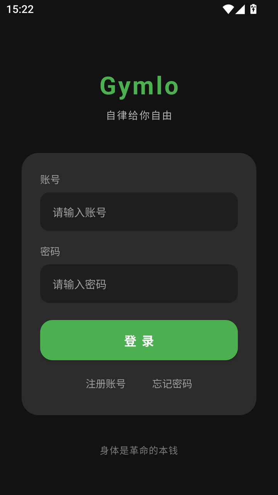 | 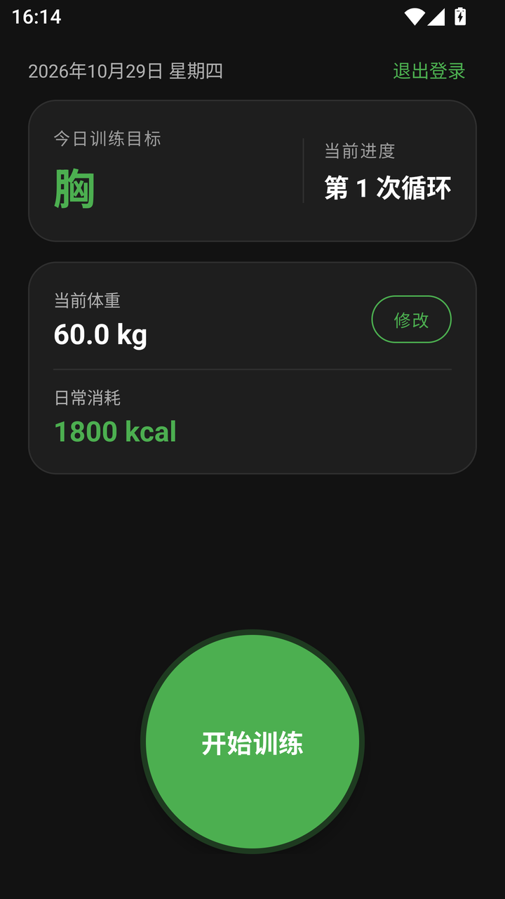 | 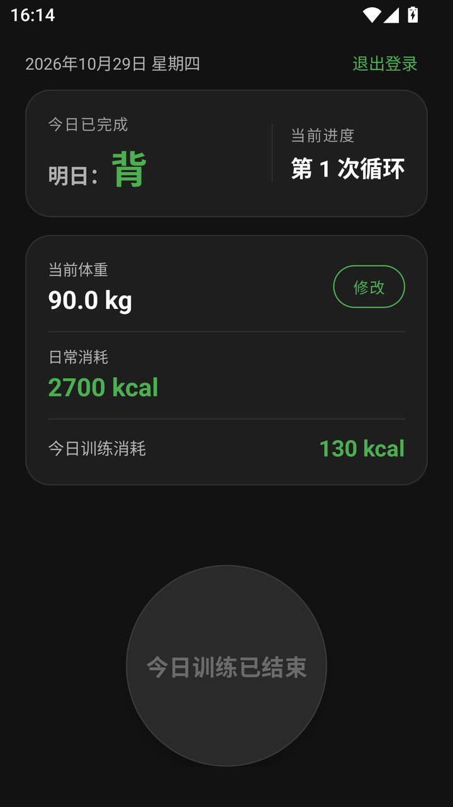 |
| **注册弹窗** | **训练页（含重量）** | **动作库** | **休息日** |
| 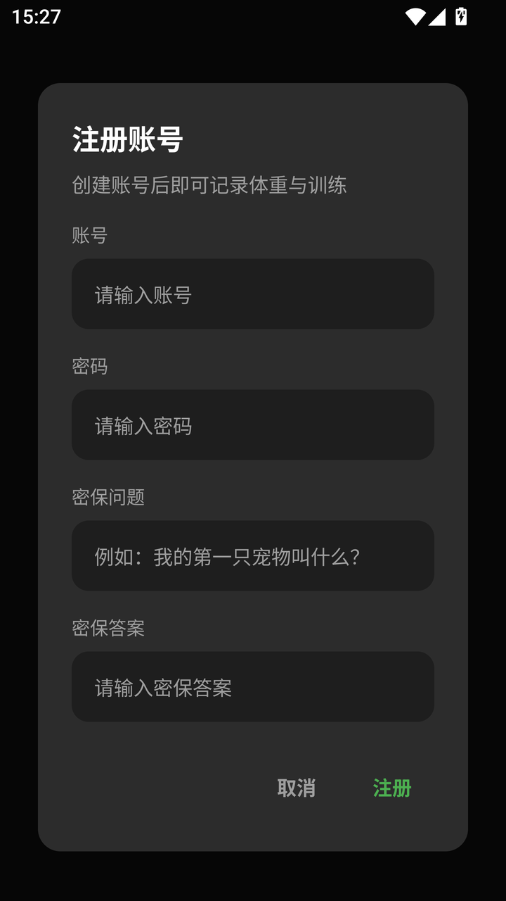 | 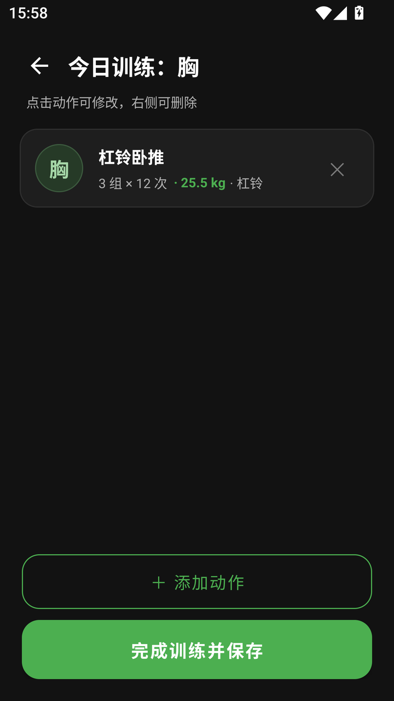 | 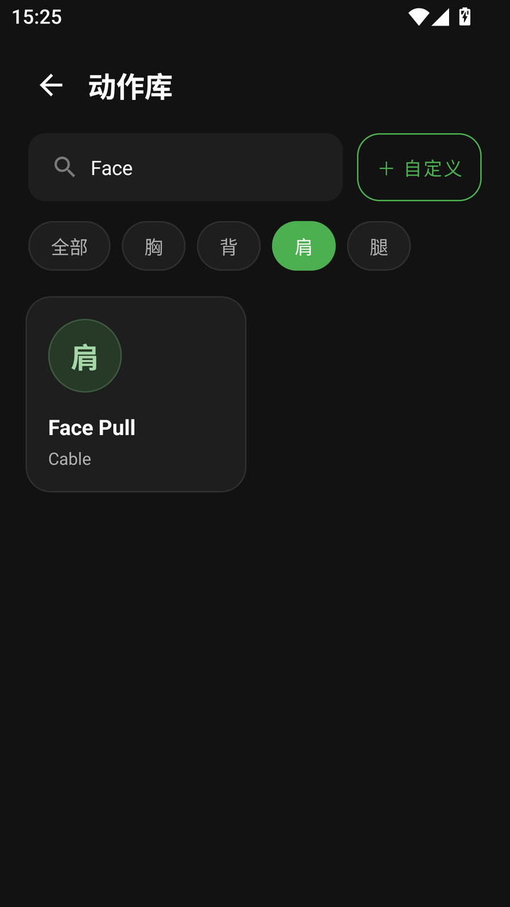 | 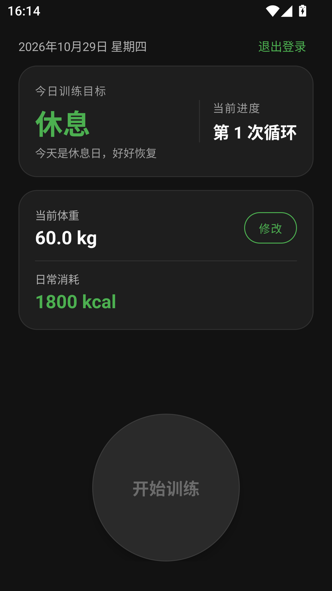 |
| **修改体重弹窗** | **组数/次数/重量弹窗** | **自定义动作弹窗** | **找回密码弹窗** |
| 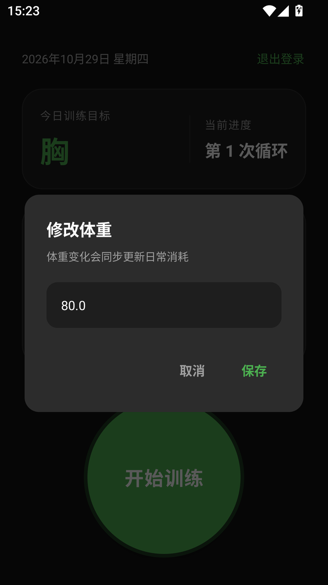 | 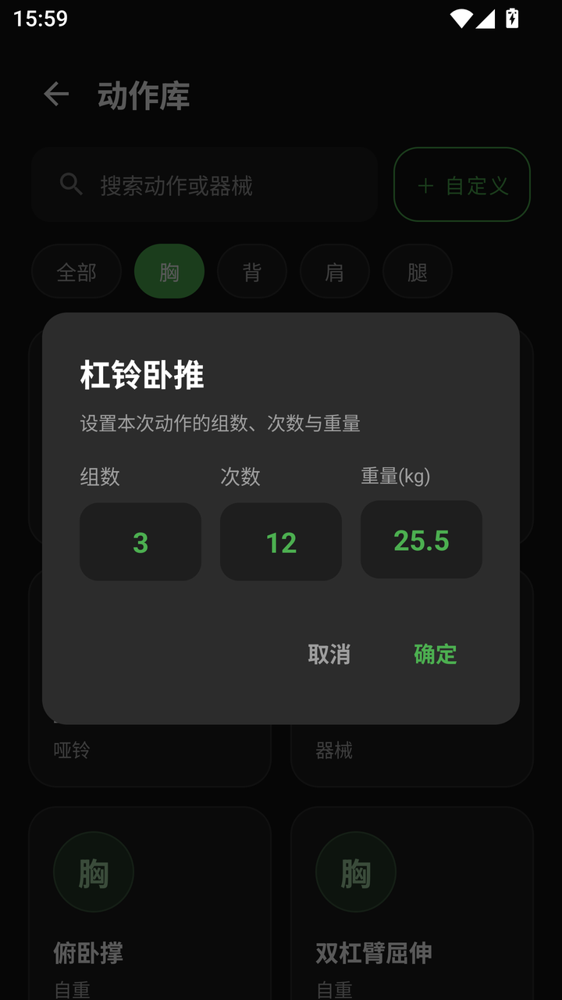 | 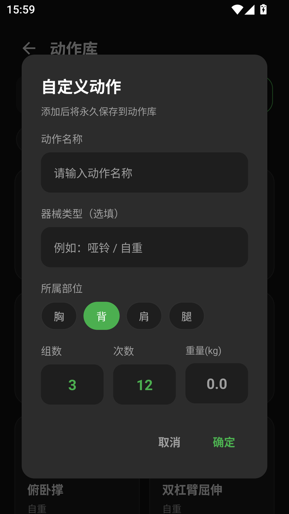 | 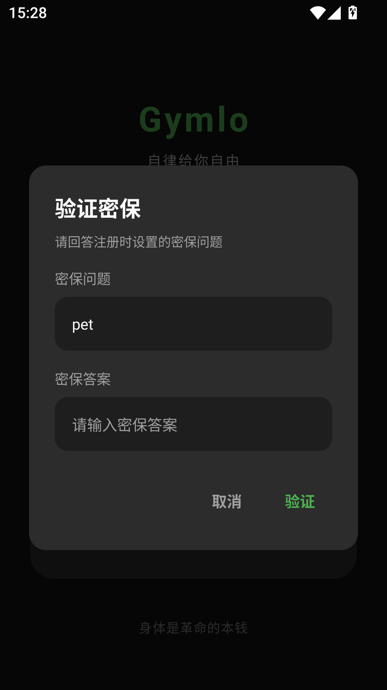 |

## 主要功能

### 首页训练状态感知

- 每次 `onResume()` 通过异步仓库查询当前 `userId` + 今天日期是否有 `TrainingRecord`。
- **状态 A（今天还没练）**：卡片标题“今日训练目标”，显示当前部位；开始按钮亮绿色可点击；“今日训练消耗”区域隐藏。
- **状态 B（今天已经练过）**：
  - 小标题改为“**今日已完成**”；
  - 大字显示“明日：**背**”（前缀小字灰色，下一部位绿色大号）；
  - 在体重卡片内显示“今日训练消耗：XXX kcal”（如 43 kcal / 130 kcal），不再使用悬浮卡片；
  - 圆形按钮置灰不可点击，文字改为“**今日训练已结束**”。
- 明日目标通过 `TrainingCycle.nextPart()` 推算：胸 → 背 → 肩 → 腿 → 休息 → 胸。
- 休息日仍保持原逻辑：按钮置灰，显示“今天是休息日，好好恢复”。

### 首页布局优化

- 整个页面（头部、今日目标卡片、体重/日常消耗/今日消耗卡片、底部按钮）统一放入**单个 ScrollView**，避免元素重叠和内容被裁切。
- 圆形按钮从 176dp 缩至 **160dp**，文字 18sp；按钮通过底部 Spacer 自然靠下。
- “今日训练消耗”合并进体重卡片作为第三行；卡片间距 14dp、内部 padding 18dp、圆角 20dp。
- “日常消耗”和“今日训练消耗”在同一屏内完整可见，无需滑动；小屏或大字体时整体可滚动。

### 训练重量与记忆

- `TrainingRecord` 新增 `weight` 字段（private float + Getter/Setter，Room v3 迁移新增 `weight REAL NOT NULL DEFAULT 0`）。
- 组数 / 次数 / 重量弹窗采用三列布局，重量输入支持小数（如 `25.5`），沿用无边框深色圆角样式。
- 点击动作库中某个动作时，异步查询该用户该动作的**最近一次记录**（`ORDER BY date DESC LIMIT 1`），自动填入上次重量并选中文本；无记录时保持空白。
- 训练列表显示为“3 组 × 12 次 · **25.5 kg** · 杠铃”，重量使用绿色强调；自动加载的历史动作同样包含重量。
- 重量仅作为训练负荷记录，日常消耗与训练卡路里仍沿用原 PRD 的公式（基于**当前体重**计算）。

### 其他既有能力

- 启动页：图片全屏、serif 衬线体两行引言（`lineSpacingExtra=12dp`、`letterSpacing=0.15`、轻微阴影、90% 白色、18sp），位于屏幕偏下方，1.5 秒渐显、2 秒跳转，隐藏状态栏。
- 多用户：注册、登录、退出、记住登录、MD5 密码、三步式密保找回密码。
- 首页：单一 ScrollView、今日目标 + 循环进度、体重/日常消耗/今日消耗同卡片、160dp 圆形开始按钮。
- 训练：自动加载同部位最近一次动作、点击修改、右侧删除、整批保存。
- 动作库：搜索、分类、2 列网格、24 个预置动作、自定义动作永久保存并合并展示。
- 全局暗黑弹窗：85% 宽度、`#2C2C2C` 圆角卡片、24dp 内边距、无边框输入框、纯文字按钮。

## 5 天循环（打卡驱动）

顺序：**胸 → 背 → 肩 → 腿 → 休息**。算法见 `util/TrainingCycle.java`。

- 无训练记录：今天练 **胸**。
- 最后一条记录日期就是今天：显示该记录部位（当天已完成打卡）。
- 最后记录是 **腿** 且距今恰好 1 天：今天 **休息**。
- 最后记录是 **腿** 且距今 ≥ 2 天：休息日已过，今天进入 **胸**。
- 其他情况：显示最后记录部位的**下一部位**；未完成打卡则一直顺延，不按自然日跳过。

## 卡路里计算

- 日常消耗：`currentWeight × 30` kcal
- 单条动作消耗：`sets × reps × currentWeight × 0.02` kcal
- 本次训练总消耗：各动作消耗之和；首页在“今日已完成”状态下显示当天总消耗。
- 系数集中在 `db/FitnessRepository.java` 的 `CALORIE_COEFFICIENT`。

## 数据库（Room v3）

| 表 | 字段 |
|---|---|
| `users` | `id` 自增主键、`account` 唯一索引、`password`（MD5）、`securityQuestion`、`securityAnswer` |
| `user_profiles` | `userId` 主键 + 外键→`users.id`（CASCADE）、`currentWeight`、`cycleCount`、`startDate` |
| `training_records` | `id`、`userId`、`date`、`bodyPart`、`exerciseName`、`equipment`、**`weight`**、`sets`、`reps`、`caloriesBurned`，含 `(userId, date)` 索引 |
| `custom_exercises` | `id`、`userId`、`name`、`equipment`、`bodyPart`，含 `userId` 索引 |

- 迁移链：v1→v2（equipment / cycleCount / startDate / custom_exercises），v2→v3（training_records.weight）。
- 所有资料、训练记录、自定义动作查询均带 `WHERE userId = ?`。
- `FitnessRepository` 单线程执行数据库操作，通过主线程 `Handler` 回调 UI；保存训练与循环数递增在同一事务中。

## 技术栈

- Java 17、AGP 8.3.1、Gradle 8.4
- `compileSdk 34` / `targetSdk 34` / `minSdk 26`
- Room **2.6.1**：`implementation room-runtime` + `annotationProcessor room-compiler`
- AppCompat / Material Components / RecyclerView / ConstraintLayout
- 无 Kotlin 源文件、无 Compose、无 kapt、无 ksp
- `settings.gradle` 使用 Aliyun google/public 镜像

## 目录结构

```text
app/src/main/
├── AndroidManifest.xml
├── java/com/example/gym/
│   ├── SplashActivity / LoginActivity / MainActivity / TrainingActivity / ExerciseSelectActivity
│   ├── GymApplication.java
│   ├── adapter/   ExerciseAdapter, CategoryAdapter, TrainingAdapter
│   ├── data/      ExerciseLibrary（24 个预置动作）
│   ├── db/        AppDatabase, UserDao, UserProfileDao, TrainingRecordDao,
│   │              CustomExerciseDao, FitnessRepository
│   ├── model/     User, UserProfile, TrainingRecord, CustomExercise,
│   │              Exercise, TrainingItem, HomeData
│   └── util/      AppDialog, Md5Utils, Prefs, TrainingCycle
└── res/
    ├── drawable/  splash_bg.jpg、圆形开始按钮、圆形部位占位、无边框输入框、
    │              Dialog 圆角背景、启动页底部渐变、图标
    ├── color/     chip / 开始按钮文字状态色
    ├── layout/    5 个 Activity + 3 个列表项 + 7 个自定义 Dialog
    └── values/    colors, strings, themes（含 values-v31 启动页）
```

## 构建与测试

前置：JDK 17、Android SDK Platform 34、Build-Tools 34.0.0。

```bash
export JAVA_HOME="C:/Program Files/Microsoft/jdk-17.0.10.7-hotspot"
./gradlew assembleDebug

# 5 天循环 / 下一部位单元测试（9 个用例）
./gradlew testDebugUnitTest
```

产物：`app/build/outputs/apk/debug/app-debug.apk`

> 本机 `gradle.properties` 通过 `org.gradle.java.home` 固定使用 JDK 17（系统默认 JDK 25 与 Gradle 8.4 不兼容）。换机器时请按实际 JDK 17 路径修改。

## 在 MuMu 上运行

```bash
"/d/Program Files/Netease/MuMu/nx_main/MuMuManager.exe" control -v 0 launch
"/d/Program Files/Netease/MuMu/nx_main/MuMuManager.exe" adb -v 0 -c connect
/d/andriod_sdk/platform-tools/adb install -r app/build/outputs/apk/debug/app-debug.apk
/d/andriod_sdk/platform-tools/adb shell am start -n com.example.gym/.SplashActivity
```

模拟器里保留了原有账号与数据（含既有账号的今日训练记录），并在测试结束后恢复为原来的登录状态；v1→v2→v3 迁移不会清空数据。**不要执行 `pm clear`**，否则会连同已有账号一起删除。测试账号：`alice / 654321`、`bob / 123456`。

## 已验证项

- Room v2→v3 迁移成功：新增 `weight` 字段，已有 3 个账号、体重、训练记录、自定义动作均保留。
- 首页状态 A：显示“今日训练目标 / 当前部位”，开始按钮亮绿，“今日训练消耗”隐藏。
- 首页状态 B：已有账号今日 2 条胸部记录 → 显示“今日已完成 / 明日：背 / 今日训练消耗 130 kcal”，按钮置灰“今日训练已结束”。
- 组数/次数/重量三列弹窗保存 25.5 kg 成功，训练列表显示 `· 25.5 kg`；同动作再次打开弹窗自动回填 25.5。
- 保存后首页显示今日消耗 43 kcal；同一天重复保存不会重复累计循环数。
- 首页重构为单一 ScrollView：日常消耗 2700 kcal 与今日消耗 130 kcal 同卡片完整可见，160dp 按钮不遮挡内容；状态 A/B 和休息日三种状态均无裁切。
- 启动页引言两行 serif 排版、行距/字距/阴影生效，位置位于屏幕下方约 20%。
- 9 个 `TrainingCycleTest` 单元测试全部通过（含 nextPart 的 5 个顺序映射和未知回退）。
- 临时测试账号已清理，原有账号数据未改动。
